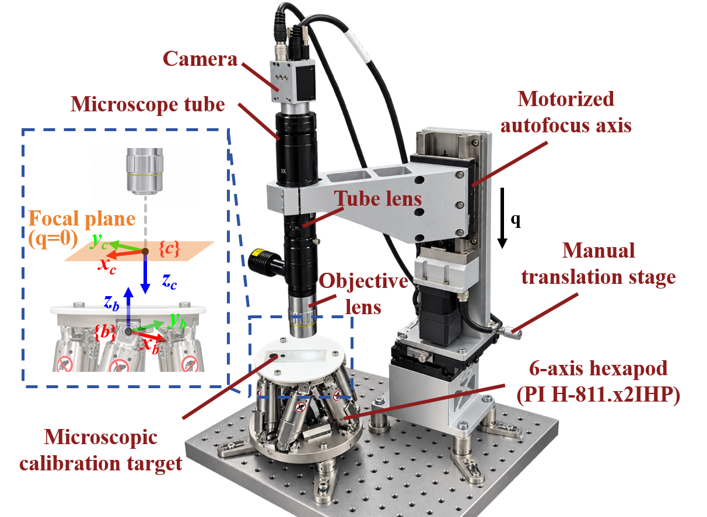

# Online Microscopic Hand-Eye Calibration in C++ and MATLAB

**OMHEC** provides the programs accompanying our work on position-only, six-degree-of-freedom hand-eye calibration for micromanipulation. The repository includes a Qt/C++ hardware application, MATLAB simulations, and offline analysis of the physical experiments.

> Haoran Cui, Weichen Dou, Jia Shi, Bowen Wang, Yuhan Chen, and Xinyu Liu, "A 6-DOF Hand-Eye Calibration Method Based on Position Residuals for Micromanipulation."

The [accompanying manuscript](docs/HandEyeCalibration.pdf) describes the model, algorithms, and evaluation. The manuscript is supplied for reference; no journal, DOI, or acceptance status is claimed here.

## Motivation

- Estimate the complete hand-eye transformation from successive 3-D positions of a single tracked feature and known robot motions.
- Account for the lower axial localization precision of microscopic vision.
- Provide the code and recorded measurements needed to reproduce the paper's simulations and physical-experiment statistics.

## Innovation

The proposed position-residual-based invariant extended Kalman filter (**PR-IEKF**) combines an analytical residual Jacobian with anisotropic measurement covariance and multiplicative updates on SE(3). The evaluation compares PR-IEKF with position-only least squares (**PO-LS**) and position-residual fixed-gain descent (**PR-FGD**).

The C++ application includes acquisition, autofocus, motion control, and calibration for the experimental setup. The MATLAB programs reproduce the simulations and analyze the recorded physical measurements. The offline MATLAB workflows require neither Qt nor experimental hardware.



## Repository structure

```text
OMHEC/
|-- C++/
|   `-- OnlineMHEC/              Qt hardware application and qmake project
|       `-- dependence/         Eigen and device/computer-vision SDK files
|-- MATLAB/
|   |-- Simulation/             Simulation data generation and Figs. 2-5
|   `-- Physical_Experiments/   Offline analysis for Figs. 7-8 and Table I
|       |-- analysis/           Analysis functions
|       `-- data/               Recorded 5X, 10X, and 20X measurements
|-- docs/                       Manuscript, setup image, and validation notes
|-- LICENSE
`-- THIRD_PARTY_NOTICES.md
```

Each MATLAB workflow creates its own `output/` directory. Paths are resolved from the source files, so the package can be used independently of the manuscript repository.

## Prerequisites

### MATLAB reproduction

- MATLAB with `tiledlayout`, `exportgraphics`, and string/table support (R2020a or later). The workflows were validated with **R2025b Update 4**; earlier releases were not tested.
- `pdflatex` on `PATH`, with the LaTeX `standalone` and `graphicx` packages, for the exact-size Fig. 3 PDF. A TeX Live installation can provide these tools.
- The programs use base MATLAB operations; no Optimization, Statistics, or Parallel Computing Toolbox calls are required by these workflows.

### C++ hardware application

- Windows x64 and a **Qt MSVC x64 kit**, with Qt Core, GUI, Widgets, StateMachine, Charts, and Concurrent; C++17 is required. MinGW cannot link the supplied MSVC SDK libraries.
- OpenCV 4.10.0, Eigen 3.4.0, Basler pylon, PI GCS2, and the AgeMotion SDK. The existing headers/import libraries and the two device DLLs are under `C++/OnlineMHEC/dependence/`.
- Install the matching OpenCV and pylon runtime distributions: their runtime DLLs are not bundled in this repository. Install the corresponding camera and motion-controller drivers for hardware use.

See the [C++ instructions](C++/OnlineMHEC/README.md) for build and deployment details, and [third-party notices](THIRD_PARTY_NOTICES.md) for dependency terms.

## Usage

### Simulations: Figs. 2-5

From the repository root, run in MATLAB:

```matlab
cd MATLAB/Simulation
run_simulation(true)                 % Reduced smoke test, including Fig. 3
run_simulation(false)                % Full manuscript configuration
```

Run one of these configurations as needed. The full configuration uses the current manuscript parameters and fixed random seeds. Quick mode reduces the number of trials and steps; its numerical results are not the paper's reported results. A new run replaces the same output files.

Optional entry points in the same directory:

```matlab
run_simulation(false, 'joint')       % Only the Fig. 3 joint-sensitivity study
run_simulation(false, 'anisotropy')  % Rerun anisotropy after a matching full run
```

The anisotropy-only workflow reuses existing results and checks configuration compatibility. Use the same quick/full setting as the preceding complete run.

| Output in `MATLAB/Simulation/output/` | Paper content |
| --- | --- |
| `figures/fig_sim_convergence.pdf` | Fig. 2: convergence |
| `figures/fig_sim_initial_error.pdf` | Fig. 3: initialization and excitation |
| `figures/fig_sim_anisotropic_noise.pdf` | Fig. 4: measurement anisotropy |
| `figures/fig_sim_noise_magnitude.pdf` | Fig. 5: noise magnitude |
| `data/paper_simulation_results.mat`, `data/joint_sensitivity/`, `data/simulation_summary.csv` | Saved numerical results |

See the [simulation instructions](MATLAB/Simulation/README.md) for units and rerunning figure export.

### Physical experiments: Figs. 7-8 and Table I

From the repository root, run in MATLAB:

```matlab
cd MATLAB/Physical_Experiments
run_analysis
```

This uses the bundled recordings for all three objective magnifications, without connecting to any device. All complete paired rounds are included. Historical CSV tags `J-FGD` and `J-RIEKF` are displayed as PR-FGD and PR-IEKF; raw files are kept unchanged.

| Output in `MATLAB/Physical_Experiments/output/` | Paper content |
| --- | --- |
| `figures/fig_exp_5x_boxplot.pdf` | Fig. 7: repeated 5X calibrations |
| `figures/fig_exp_magnification_comparison.pdf` | Fig. 8: objective magnifications |
| `tables/physical_magnification_comparison_table.tex` | Table I |
| `data/*.csv` | Per-round results, aggregate statistics, conditions, and covariance |

See the [physical-analysis instructions](MATLAB/Physical_Experiments/README.md) for input data and units. Fig. 6 is the experimental setup illustration, rather than an analysis output.

### C++ hardware experiments

Open `C++/OnlineMHEC/OnlineMHEC.pro` in Qt Creator with a compatible MSVC x64 kit. Build the application and follow the [hardware instructions](C++/OnlineMHEC/README.md). MATLAB reproduction is the entry point for readers who do not have the experimental setup.

## Validation

The independent-copy checks, environment, and remaining hardware limitations are recorded in [docs/VALIDATION.md](docs/VALIDATION.md). Generated results, executables, and personal IDE settings are excluded from version control.

## Contributing

Please use the issue tracker for questions and bug reports. Include the operating system, MATLAB release or Qt/compiler/SDK versions, the command used, and a minimal reproducible example. Pull requests should describe their effect on the numerical results or hardware configuration.

## Citations

If you use the programs or data, please cite the accompanying manuscript:

> H. Cui, W. Dou, J. Shi, B. Wang, Y. Chen, and X. Liu, "A 6-DOF Hand-Eye Calibration Method Based on Position Residuals for Micromanipulation."

Bibliographic details can be updated when a publication record is available.

## License

The original OMHEC software and software documentation are released under the [MIT License](LICENSE), copyright (c) 2026 Haoran Cui. Bundled third-party components retain their own terms; see [THIRD_PARTY_NOTICES.md](THIRD_PARTY_NOTICES.md). The manuscript and setup illustration retain their authors' rights and are not relicensed by the software license.
